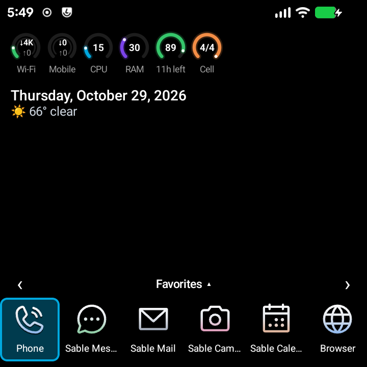
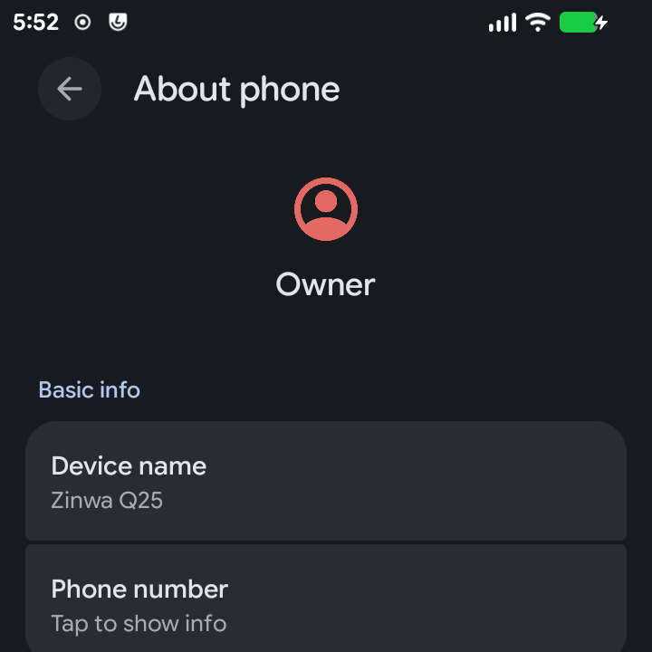

# Screenshots

Taken from a Zinwa Q25 running SableOS with `scripts/capture-screenshots.sh`.
Back to the [User Guide](USER_GUIDE.md).

To retake them: plug in a Q25 with USB debugging on, then run
`bash scripts/capture-screenshots.sh --serial $(adb get-serialno)`. Shots listed in
[screenshots.tsv](screenshots.tsv) open by themselves or ask you to open the screen.

## The Start home screen, BlackBerry 7 style (set Home screen style to BlackBerry 7 in Sable Setup first, then put it back)

Sable Start (home-bb7)

## Settings > About phone, with the SableOS version row

First-boot setup (about-phone)

